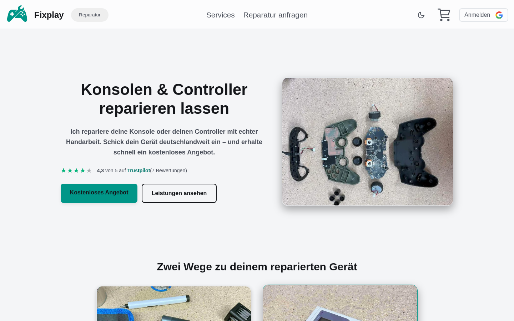
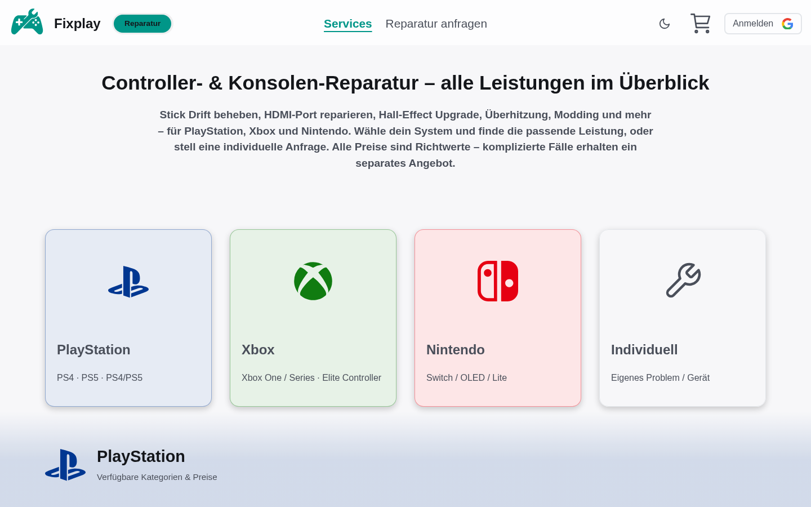
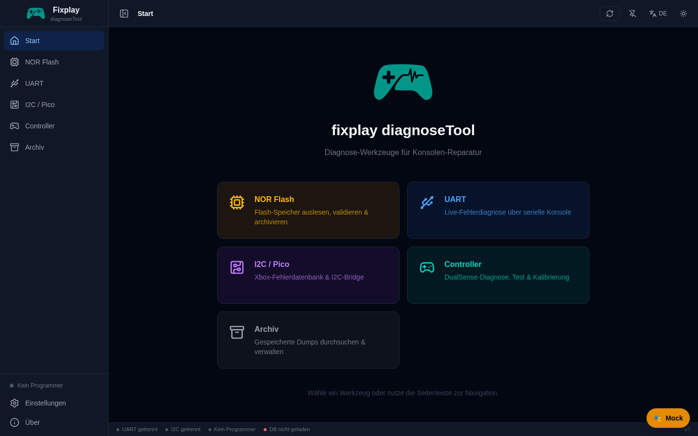
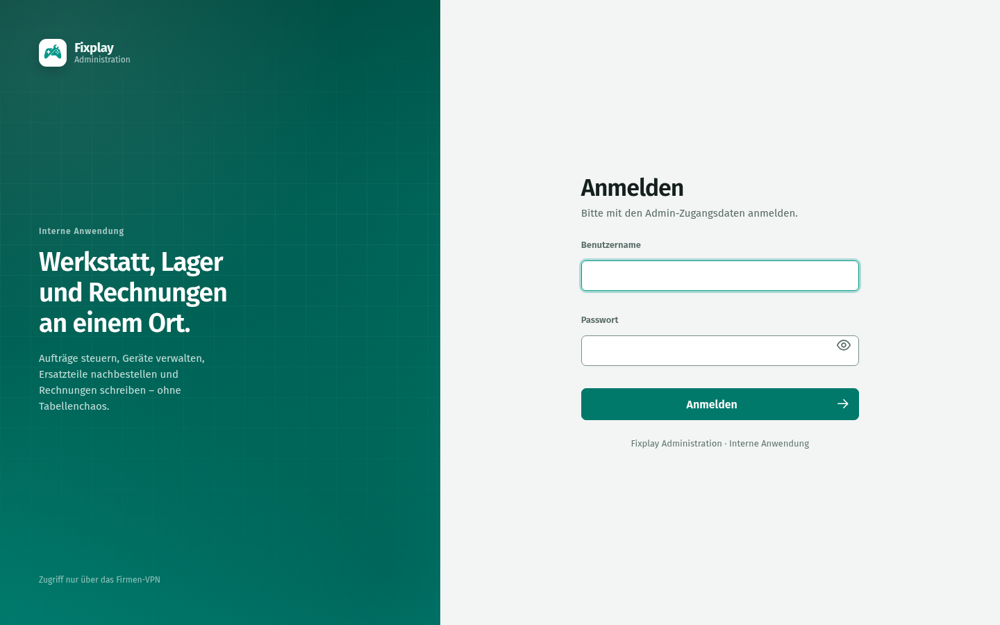
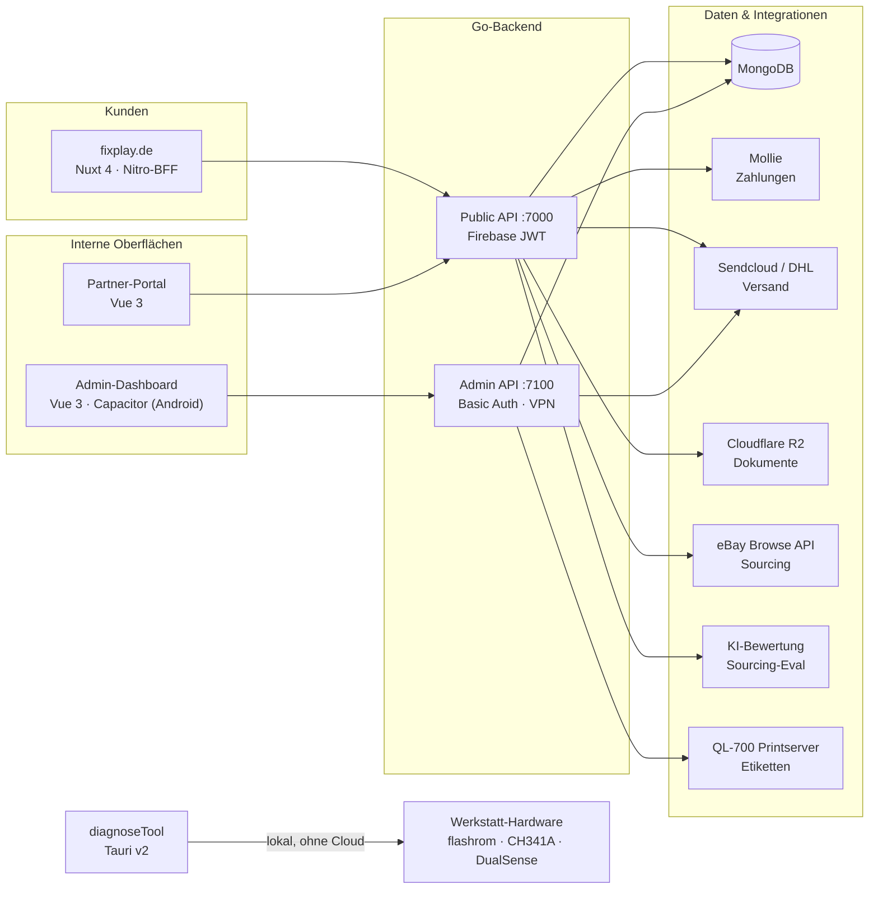
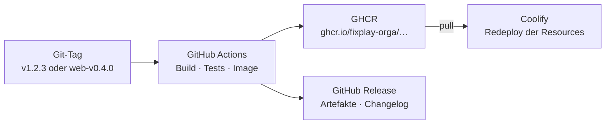

  

<h1 align="center">Fixplay</h1>

  <strong>Reparaturplattform für Konsolen, Controller und Smartphones</strong> 
  Königslutter am Elm · <a href="https://fixplay.de">fixplay.de</a> · <a href="https://partners.fixplay.de">partners.fixplay.de</a>

  
  
  
  
  
  
  

---

Fixplay verbindet die Werkstatt mit Kunden, Partnern und dem eigenen
Werkstatt-Alltag — von der öffentlichen Website über die Auftragsabwicklung im
Backoffice bis zur Hardware-Diagnose auf dem Werktisch:

- **Kundenshop und Reparaturannahme** auf [fixplay.de](https://fixplay.de):
  Preisanfrage, Auftrag, Versand, Zahlung und Statusverfolgung.
- **Backoffice** für Werkstatt, Lager und Rechnungen — im Browser und als
  Android-App, im Produktivbetrieb nur über VPN erreichbar.
- **Partner-Portal** für Sucher und Vertrieb mit eigenen Rechten und
  Sichtbarkeiten.
- **diagnoseTool** für NOR-Flash, UART, I²C und Controller-Diagnose direkt an
  der Werkbank — ohne Cloud-Zwang.

## Ein Blick auf die Plattform

<table>
  <tr>
    <td width="50%" align="center">
       
      <strong>fixplay.de</strong> — Reparaturannahme mit Live-Preisberatung
    </td>
    <td width="50%" align="center">
       
      <strong>Leistungen</strong> — Plattform, Fehlerbild und Preis auf einen Blick
    </td>
  </tr>
  <tr>
    <td width="50%" align="center">
       
      <strong>diagnoseTool</strong> — NOR-Flash, UART, I²C und Controller-Tests
    </td>
    <td width="50%" align="center">
       
      <strong>Administration</strong> — Werkstatt, Lager und Rechnungen (VPN)
    </td>
  </tr>
</table>

## Systemüberblick

**Kurz erklärt**

- Beide APIs teilen sich den Go-Code (`internal/`), laufen aber als getrennte
  Binaries mit eigenen Ports, Auth-Verfahren und Deployments — der öffentliche
  Traffic erreicht nie die Admin-API.
- Der Nitro-BFF des Kundenshops hält Firebase-Tokens aus dem Browser heraus
  und spricht die Public API über den versionierten OpenAPI-Contract an.
- diagnoseTool arbeitet vollständig lokal: Rust-Traits trennen Hardwarezugriff
  von der UI, Mock-Implementierungen erlauben Tests und Entwicklung ohne
  angeschlossenes Gerät.

## Repositories

| Repository | Zweck | Stack | Auslieferung |
|---|---|---|---|
| [`fixplay-backend`](https://github.com/fixplay-orga/fixplay-backend) | Public API (`:7000`, Firebase JWT) und Admin API (`:7100`, Basic Auth) | Go 1.25 · Echo · MongoDB | Container-Images `v*` |
| [`fixplay-frontend`](https://github.com/fixplay-orga/fixplay-frontend) | Kundenshop und Reparaturplattform auf fixplay.de | Nuxt 4 · Nitro-BFF · OpenAPI-Contract | Web-Image `web-v*` |
| [`fixplay-frontend-admin`](https://github.com/fixplay-orga/fixplay-frontend-admin) | Admin-Dashboard im Browser und als Android-App | Vue 3 · PrimeVue · Capacitor | Web-Image + APK |
| [`fixplay-frontend-partners`](https://github.com/fixplay-orga/fixplay-frontend-partners) | Partner-Portal für Sucher und Vertrieb | Vue 3 · Firebase Auth | Web-Image `web-v*` |
| [`fixplay-backup`](https://github.com/fixplay-orga/fixplay-backup) | Wartungs- und Ausweichseite für fixplay.de | Statisches HTML · nginx | Container-Image `v*` / `latest` |
| [`fixplay-diagnoseTool`](https://github.com/fixplay-orga/fixplay-diagnoseTool) | Desktop-Tool für NOR-Flash, UART, I²C und Controller-Diagnose | Tauri v2 · Rust · Svelte 5 | GitHub Releases (Win/Linux, AUR) |
| [`ql700-printserver`](https://github.com/fixplay-orga/ql700-printserver) | Etikettendruck-Server für den Brother QL-700 | Python · FastAPI · pyusb | systemd auf dem Print-Pi |

Archiviert: [`fixplay-frontend-legacy`](https://github.com/fixplay-orga/fixplay-frontend-legacy)
(Vue-3-Kundenshop) und
[`fixplay-backend-legacy`](https://github.com/fixplay-orga/fixplay-backend-legacy)
(Java/Javalin-Backend) — bleiben als Referenz und für die Datenhistorie
erhalten.

## Releases, Container-Images und der Packages-Tab

Jedes Repository baut und veröffentlicht selbst; die Organisation ist nur der
gemeinsame Namensraum. Der Ablauf ist derselbe:

Sobald ein Release-Tag gesetzt wird, erscheinen die Images automatisch im
Reiter **Packages** dieser Organisation:

| Package | Quelle | Tag-Schema |
|---|---|---|
| `ghcr.io/fixplay-orga/fixplay-public-api` | `fixplay-backend` | `v*`, `latest` |
| `ghcr.io/fixplay-orga/fixplay-admin-api` | `fixplay-backend` | `v*`, `latest` |
| `ghcr.io/fixplay-orga/fixplay-frontend-admin` | `fixplay-frontend-admin` | `web-v*`, `latest` |
| `ghcr.io/fixplay-orga/fixplay-frontend` | `fixplay-frontend` | `web-v*`, `latest` |
| `ghcr.io/fixplay-orga/fixplay-frontend-partners` | `fixplay-frontend-partners` | `web-v*`, `latest` |
| `ghcr.io/fixplay-orga/fixplay-backup` | `fixplay-backup` | `v*`, `latest` |

Die Workflows leiten den Namensraum aus `${{ github.repository_owner }}` ab —
neue Pakete landen also ohne weitere Änderung in der Organisation. Bereits
vorhandene Images aus der Zeit vor dem Umzug behalten ihren alten Namespace,
bis sie neu getaggt oder in den Einstellungen des Packages übertragen werden.

## Deployment mit Coolify

Produktiv laufen die Dienste auf einem **Coolify**-Server. Coolify zieht die
fertig gebauten Images aus GHCR und startet sie mit den Runtime-Variablen der
jeweiligen Resource — auf dem Zielhost wird **nichts gebaut**. Einen
SSH- oder Compose-Deploy aus der CI gibt es nicht mehr.

- **Ablauf:** Tag pushen → GitHub Actions testet, baut und pusht das Image →
  Coolify zieht den neuen Tag und startet den Container neu.
- **Auto-Deploy (optional):** Ist im Repository das Secret `COOLIFY_WEBHOOK`
  (und bei geschützter API zusätzlich `COOLIFY_TOKEN`) gesetzt, löst der
  Release-Workflow den Redeploy über die Coolify-API aus. Ohne diese Secrets
  endet der Job grün; der Deploy bleibt dann manuell (Tag in Coolify setzen
  und „Redeploy“ drücken).
- **Private Images:** Die GHCR-Pakete sind privat. Der Coolify-Server braucht
  einmalig einen classic PAT mit `read:packages` und einen
  `docker login ghcr.io` (Details in den `docs/COOLIFY.md` bzw.
  `docs/DEPLOYMENT.md` der Repositories).
- **Konfiguration:** ausschließlich über Umgebungsvariablen der
  Coolify-Resource. Ein Image ist für alle Umgebungen identisch; Änderungen an
  Werten brauchen nur einen Redeploy, kein neues Release.
- **Rollback:** älteren `v*`- bzw. `web-v*`-Tag in Coolify setzen und neu
  deployen. Die historischen Tags bleiben in GHCR erhalten.
- **Netz:** fixplay.de, die Public API und die Partner-Anmeldung sind
  öffentlich; Admin-Dashboard, Admin-API und interne Bereiche liegen hinter
  dem WireGuard-VPN.

## Arbeitsweise

- **Contract-first:** Das Backend veröffentlicht seine OpenAPI-Spec als
  Release-Asset; die Frontends pinnen Version und SHA256, statt eine Spec von
  Hand zu pflegen. Contract-Brüche fallen in CI auf, nicht im Browser.
- **Getrennte Oberflächen:** Kunden-, Admin- und Partner-Portal haben eigene
  APIs, Auth-Verfahren und Deployments. Interne Bereiche sind nie öffentlich
  verlinkt; fehlende Rechte führen bewusst auf 404 statt 403.
- **Testbar ohne Hardware und ohne Fremdsysteme:** Rust-Hardwarezugriffe laufen
  hinter Traits mit Mocks, Go-Tests nutzen `testify/mock`, die Frontends
  Vitest, MSW und Docker-Rezepte für reproduzierbare Builds.
- **Deutsch als Produktsprache**, Code, Kommentare und Commits auf Englisch —
  mit deutschen Fachbegriffen dort, wo sie eindeutiger sind.
- **Release über Tags, nicht über Handarbeit:** `v*` für Backend, Backup-Seite
  und diagnoseTool, `web-v*` für Web-Images. `main` ist der Integrationsbranch;
  ausgeliefert wird ausschließlich über Tags und die daraus gebauten Images.

## Sicherheit

Bitte Schwachstellen nicht als öffentliches Issue melden. Nutze
**Security → Report a vulnerability** im betroffenen Repository oder wende dich
vertraulich an den Repository-Owner. Details stehen in
[`SECURITY.md`](SECURITY.md). Zugangsdaten und API-Keys liegen ausschließlich in
GitHub Secrets bzw. `.env`-Dateien und werden nie committet.
